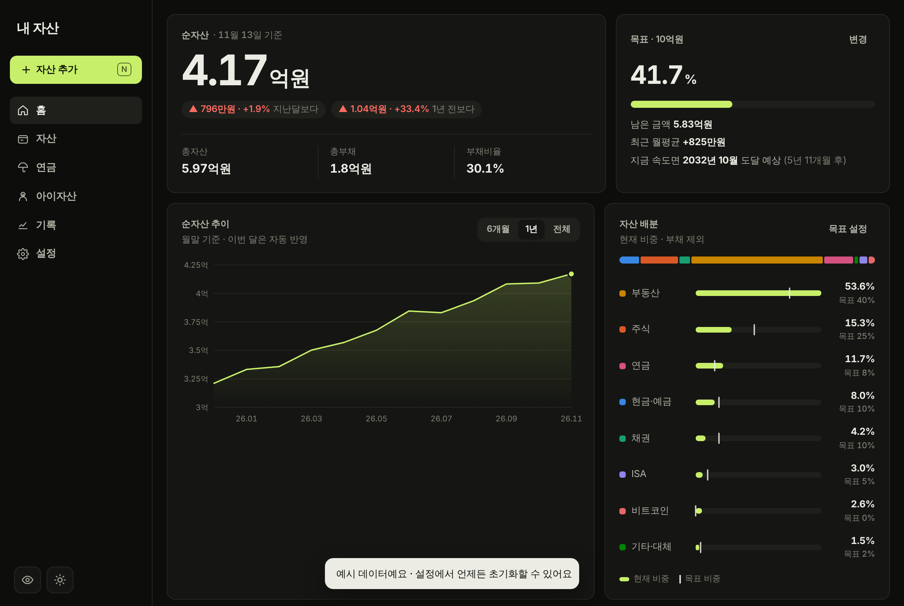

# Dashboards

This repository contains two independent dashboards. Both are deployed from the `master` branch with GitHub Pages.

| Dashboard | Open | Location | Docs |
| --- | --- | --- | --- |
| 💰 **Asset manager** | https://hyeongu-kwon.github.io/test/ | [`index.html`](index.html) | [below](#-asset-manager) |
| 🎬 **Travel videos** | https://hyeongu-kwon.github.io/test/video-dashboard/ | [`video-dashboard/`](video-dashboard/) | [video-dashboard/README.md](video-dashboard/README.md) |

Changes go through a working branch → pull request → merge into `master`, and appear on the site 1–2 minutes after the merge.

📘 한국어 문서: [README.md](README.md)

---

## 💰 Asset manager

A personal asset dashboard that runs in the browser without installation. On a phone you can add it to the home screen and use it like an app.

### Screens
- **Home**: net worth (vs. last month and a year ago), total assets, total debt and debt ratio, goal progress with a projected date, net worth trend (6 months / 1 year / all), allocation vs. target, automatic checkpoints
- **Assets**: one tab per category (cash, stocks, ISA, bonds, real estate, pensions, Bitcoin, other, debt) with totals, shares, returns and trend charts; search; tap an item to edit
- **Pensions**: pension savings, IRP and retirement accounts; estimated tax credit this year and the remaining limit; estimated monthly income after retirement (including the national pension)
- **Kids' assets**: a separate space that is not included in your net worth. Per-child holdings and trends, gift records, and tracking of the 10-year combined gift deduction (₩20M for minors, ₩50M for adults)
- **History**: monthly totals for assets, debt and net worth (the current month is recorded automatically; past months can be added or edited)
- **Settings**: goal, target allocation, exchange rate, monthly expenses, backup/restore (JSON), CSV export, paste from Excel, share links, sample data, full reset

### Features
- Enter holdings as quantity × price; convert USD assets with an exchange rate; returns when you enter cost basis
- Hide amounts, light/dark theme (dark by default)
- Undo for deletes and resets
- Shortcuts: `N` add, `/` search, `H` hide amounts, `L` lock, `1`–`6` switch tabs

### Sign in from any device (account mode)
Sign up with an ID and password to view and edit the same data from a PC or a phone. The server is [Supabase](https://supabase.com) (free tier). The connection settings live in the `CLOUD` constant in `index.html`.

**How it works**
- Opening the app shows a sign-in screen. The first time, choose "Create account" to set an ID and password. Data already on that device is moved into the account.
- Each change is saved to the server right away. Other devices load the latest version when you return to the app. If two devices change data at the same time, you are asked which version to keep.
- After 5 wrong passwords the account is locked for 5 minutes. Change password, sign out and delete account are in the Settings tab.
- Data is encrypted in the browser before it is uploaded, so the server cannot read it. The password is never stored on the server. **If you forget the password, the data cannot be recovered.**

**To use a different Supabase project**
1. Paste the contents of `supabase/setup.sql` into the SQL Editor and run it.
2. In Project Settings → API, copy the Project URL and the **publishable (anon) public key** into `CLOUD`.
3. Never put the `service_role` (secret) key in the app.
4. Leave the values empty to run without a server, with data kept only on the device.

### Device-only mode (login lock and share links)
- **Login lock**: Settings → turn on the login lock. Data is encrypted with a key derived from the ID and password and stored only on this device. Supports auto-lock and changing the ID and password.
- **Share links**: Settings → create a share link. The data is compressed into the URL after `#`, so it is not sent to a web server. The recipient gets a read-only copy, which can be protected with a password. The link is a snapshot of the moment it was created.

### Design notes
- **End-to-end encryption**: a key is derived from the password with PBKDF2 (SHA-256, 310,000 iterations). Data is encrypted with AES-256-GCM before upload. The key never leaves the device; the server stores only ciphertext and a hash used for authentication.
- **Restricted server access**: the `vaults` table cannot be read or written directly from outside. Access goes only through defined functions (RPC). Lockout after repeated failures is also enforced in the database.
- **Concurrent edit detection**: saves compare a revision number. On conflict, the user is asked which version to keep. Changes made offline are saved when the connection returns.

### Tech stack
- Front end: plain HTML, CSS and JavaScript (no framework, no build step)
- Cryptography: Web Crypto API (PBKDF2, AES-GCM) and Compression Streams API
- Back end: Supabase (Postgres with RPC functions and Row Level Security)
- Hosting: GitHub Pages, with a PWA manifest for home-screen install

### Limitations
- The Supabase free tier may pause projects that are unused for a long time.
- If you forget the password, the data cannot be recovered. Keep a backup file.
- Market prices are not fetched automatically. Enter current values yourself.
- Tax rules used for the pension credit and gift deduction reflect the time of writing. Check them before filing.

---

## 🎬 Travel video dashboard
See [video-dashboard/README.md](video-dashboard/README.md) for details.
