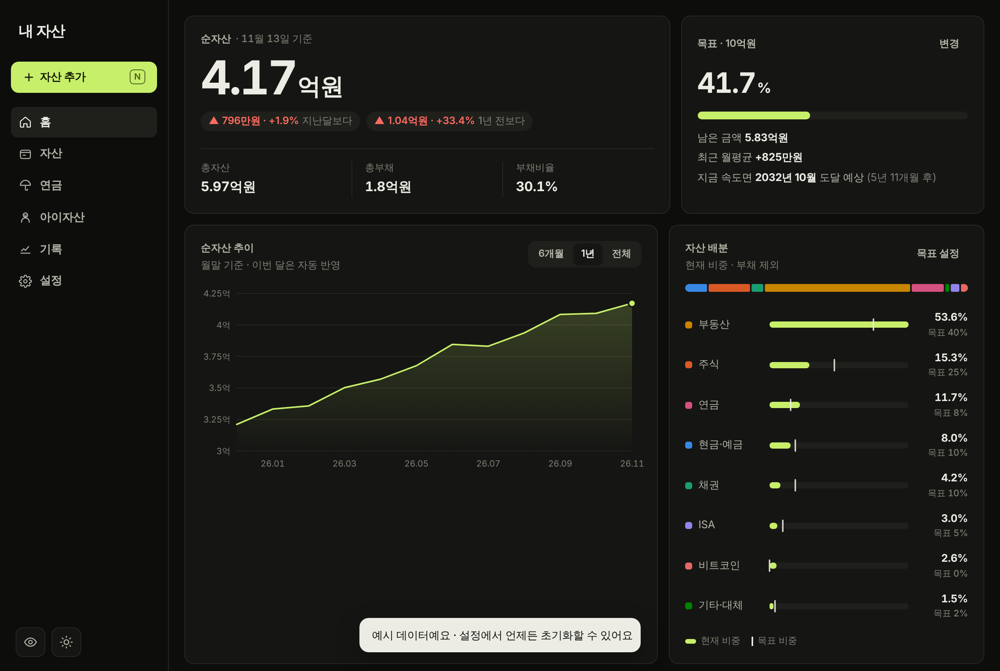

# 내 자산 · 여행 영상 대시보드

정적 웹(HTML/CSS/JS)으로 만든 개인 프로젝트 모음입니다. 서버는 Supabase만 사용하고, 나머지는 GitHub Pages에 그대로 올라가는 파일입니다.

| 프로젝트 | 설명 | 주소 |
| --- | --- | --- |
| **[자산관리 대시보드](#자산관리-대시보드)** | 자산·연금·아이자산을 한곳에서 관리. 아이디·비밀번호 로그인과 기기 간 동기화, 종단간 암호화 | [열기](https://hyeongu-kwon.github.io/test/) |
| **[여행 영상 대시보드](video-dashboard/README.md)** | 여행 영상 업로드와 계정별 권한(관리자·게스트)이 있는 공유 갤러리 | [열기](https://hyeongu-kwon.github.io/test/video-dashboard/) |



---

## 자산관리 대시보드

### 주요 기능
- **홈**: 순자산(전월·1년 전 대비), 총자산·총부채·부채비율, 목표 달성률과 도달 예상 시점, 순자산 추이, 자산 배분(현재 vs 목표), 자동 점검 항목
- **자산**: 분류별 탭(현금·주식·ISA·채권·부동산·연금·비트코인·기타·부채)마다 합계·비중·수익률·추이 그래프, 검색, 수량 × 현재가 입력, 달러 환산
- **연금**: 연금저축·IRP·퇴직연금 계좌 관리, 연간 세액공제 예상 환급액과 남은 한도, 은퇴 후 예상 월 수령액
- **아이자산**: 전체 자산과 분리된 공간. 아이별 자산 관리와 증여 기록, 10년 합산 공제 한도 추적
- **기록**: 월별 자산·부채·순자산 자동 기록, 지난 달 직접 추가·수정
- **설정**: 목표·환율·생활비, 백업/복원(JSON), CSV 내보내기, 엑셀 붙여넣기, 공유 링크

### 설계 포인트
- **종단간 암호화**: 비밀번호에서 PBKDF2(SHA-256, 31만 회)로 암호화 키를 만들고, 데이터는 AES-256-GCM으로 암호화한 뒤 업로드합니다. 암호화 키는 기기 밖으로 나가지 않으며, 서버에는 암호문과 인증용 해시만 남습니다.
- **서버 접근 제한**: `vaults` 테이블은 외부에서 직접 읽거나 쓸 수 없고, 정의된 함수(RPC)로만 접근합니다. 비밀번호 5회 실패 시 5분 잠금을 DB 안에서 처리합니다.
- **동시 수정 감지**: 저장할 때 리비전 번호를 비교해 충돌하면 어느 쪽을 남길지 묻습니다. 오프라인에서 바꾼 내용은 연결되면 다시 저장합니다.
- **기기 우선 동작**: 서버 설정이 없으면 모든 데이터를 브라우저 저장소에만 두고, 같은 암호화 방식으로 기기 잠금을 제공합니다.
- **읽기 전용 공유 링크**: 데이터를 압축해 URL의 `#` 뒤에 담습니다. 이 부분은 웹 서버로 전송되지 않으며, 비밀번호를 걸 수 있습니다.

### 기술 스택
- 프런트엔드: 순수 HTML / CSS / JavaScript (프레임워크·빌드 도구 없음)
- 암호화: Web Crypto API (PBKDF2, AES-GCM), Compression Streams API
- 백엔드: Supabase (Postgres + RPC 함수, Row Level Security)
- 배포: GitHub Pages, PWA 매니페스트로 홈 화면 설치 지원

### 구조
```
index.html              자산관리 대시보드 (단일 파일 앱)
manifest.webmanifest    홈 화면 설치 정보
icons/                  앱 아이콘
supabase/setup.sql      서버 설정 (Supabase SQL Editor에서 한 번 실행)
video-dashboard/        여행 영상 대시보드 (별도 앱)
docs/screenshots/       화면 캡처
```

### 직접 설정해서 쓰기
1. [supabase.com](https://supabase.com)에서 프로젝트를 만듭니다.
2. SQL Editor에 `supabase/setup.sql` 내용을 붙여넣고 실행합니다.
3. Project Settings → API에서 Project URL과 **publishable(anon) 공개 키**를 복사합니다.
4. `index.html`의 `const CLOUD = ...` 줄에 두 값을 넣고 배포합니다.
   - `service_role`(secret) 키는 절대 넣지 마세요.
5. 값을 비워 두면 서버 없이 기기 안에서만 동작합니다.

### 한계
- 계정 데이터는 Supabase 무료 플랜 범위에서 동작하며, 장기간 미사용 시 프로젝트가 일시 중지될 수 있습니다.
- 비밀번호를 잊으면 데이터를 복구할 수 없습니다. 백업 파일을 함께 보관하세요.
- 투자 시세는 자동으로 가져오지 않습니다. 평가금액은 직접 입력합니다.
- 세법 기준(연금 세액공제, 증여재산공제)은 작성 시점의 내용이라 실제 신고 전에 확인이 필요합니다.

---

## 여행 영상 대시보드
자세한 내용은 [video-dashboard/README.md](video-dashboard/README.md)를 보세요.
