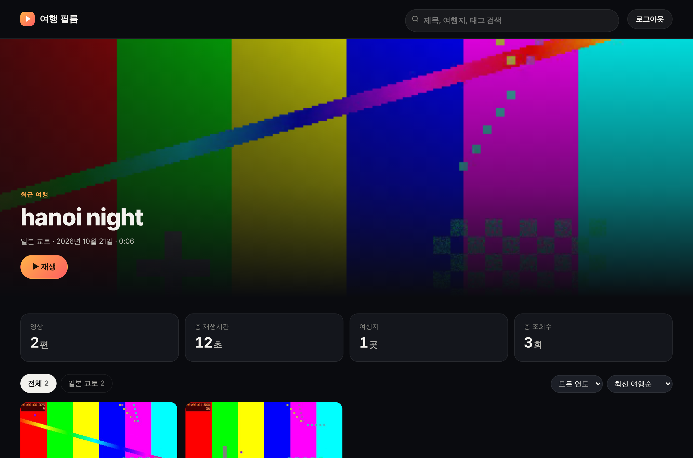
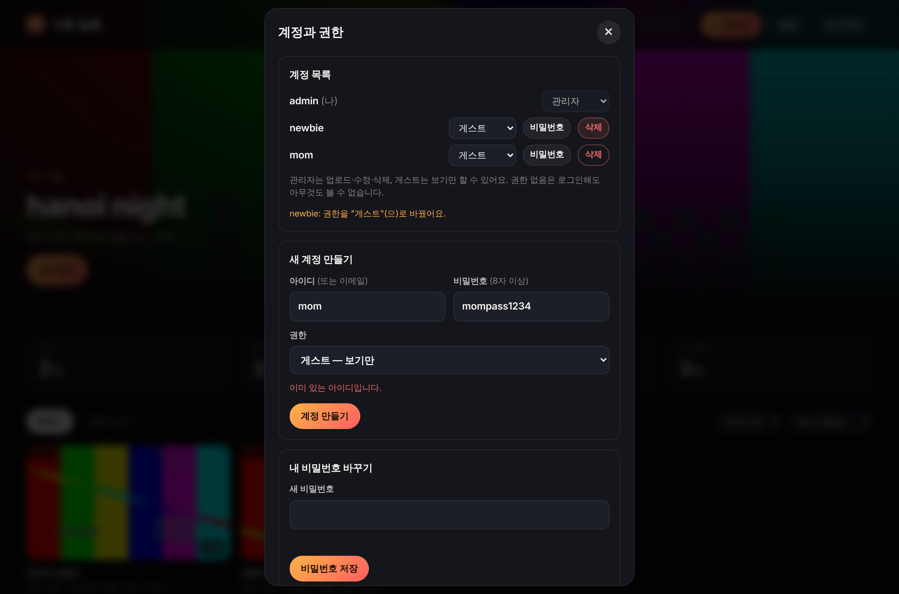

# 🎬 Travel Video Dashboard

A dashboard for uploading travel videos, viewable only by people who log in.

🇰🇷 [한국어 README](README.md)

**Open it → https://hyeongu-kwon.github.io/test/video-dashboard/**

| | |
| --- | --- |
| Front end | Static page (GitHub Pages, `master` branch) |
| Login · DB · video storage | Supabase project `Movie` |
| Relation to the asset dashboard | Separate folder in the same repository; **a different Supabase project** |



<details><summary>Account settings screen (admin)</summary>



</details>

> The screenshots were taken with sample test videos. They contain no real travel footage or account data.

## Contents
- [How to use](#how-to-use)
- [Accounts and permissions](#accounts-and-permissions)
- [Limits](#limits)
- [Useful Supabase pages](#useful-supabase-pages)
- [Troubleshooting](#troubleshooting)
- [How changes are deployed](#how-changes-are-deployed)
- [Files](#files)
- [Setting up from scratch](#setting-up-from-scratch)
- [Design notes](#design-notes)
- [Changelog](#changelog)

## How to use
| Task | How |
| --- | --- |
| Watch a video | Tap a card to play it large. Previous/next buttons; when a video ends, the next one can continue automatically |
| Find a video | Search (title, place, tags), place chips, year filter, sorting |
| Upload a video *(admin)* | **＋ Upload** → choose videos → enter title, place, date, tags → upload. Several videos can be added at once; duration and thumbnail are generated automatically |
| Edit video details *(admin)* | **Edit** on the playback screen (on a PC, the edit button also appears when hovering a card) |
| Change a thumbnail *(admin)* | While playing, **Use this frame as thumbnail** at the desired moment, or pick an image file in the edit screen |
| Pin a featured video to the top *(admin)* | Edit → **Feature on the home screen**. If nothing is pinned, the most recent trip is shown |
| Delete a video *(admin)* | Edit → **Delete** (the video file is removed too and cannot be recovered) |

The featured video at the top plays automatically, muted. On a PC, hovering a card shows a muted preview.

## Accounts and permissions
| Role | What it can do |
| --- | --- |
| **Admin** (`admin`) | View, upload, edit, delete, manage accounts |
| **Guest** (`guest`) | View, search and filter only |
| **Pending** (`pending`) | Can log in but sees nothing |

Admins manage accounts in **Settings**:
- **Create account** — choose ID, password and role
- **Change role**, **change password**, **delete account**
- An admin cannot lower their own role or delete their own account (this prevents the dashboard from ending up with no admin)

If an ID has no `@`, `loginDomain` from `config.js` is appended (`guest` → `guest@travel.film`). It does not need to be a real mailbox.

Permissions are enforced by **Supabase database access rules (RLS)**, not by hiding buttons. A guest who calls the API directly is still refused for uploads, edits, deletes and role changes. Video files live in a private store and cannot be opened without logging in.

## Limits
| Item | Limit | Notes |
| --- | --- | --- |
| One video | **50 MB** | Project limit on Supabase's free plan. For a 2-minute clip, export at about 3 Mbps or lower |
| Total storage | About 1 GB | Free plan; roughly 20 videos of 50 MB |
| Formats | MP4, MOV, WebM | For playback on all devices, **H.264 + AAC MP4** is recommended |
| Thumbnail | 5 MB | JPG, PNG, WebP |

Free-plan figures can change. Check the [Storage settings](https://supabase.com/dashboard/project/gbjvqjqdetesjhmelnfi/storage/settings). A paid plan raises the limit on the same page, and no code changes are needed.

To re-encode a smaller file:
```bash
ffmpeg -i input.mov -c:v libx264 -b:v 3M -vf scale=-2:1080 -c:a aac -b:a 128k -movflags +faststart output.mp4
```

## Useful Supabase pages
| Page | Purpose |
| --- | --- |
| [SQL Editor](https://supabase.com/dashboard/project/gbjvqjqdetesjhmelnfi/sql/new) | Run `setup.sql` |
| [Authentication → Users](https://supabase.com/dashboard/project/gbjvqjqdetesjhmelnfi/auth/users) | Account list (the app's Settings is usually enough) |
| [Storage](https://supabase.com/dashboard/project/gbjvqjqdetesjhmelnfi/storage/buckets) | Uploaded videos (`videos`) and thumbnails (`thumbs`) |
| [Storage settings](https://supabase.com/dashboard/project/gbjvqjqdetesjhmelnfi/storage/settings) | Upload limit |
| [API Keys](https://supabase.com/dashboard/project/gbjvqjqdetesjhmelnfi/settings/api-keys) | Connection keys |

## Troubleshooting
| Symptom | What to check |
| --- | --- |
| A change does not appear on the site | It takes 1–2 minutes. Reload two or three times, or open the page with `?v=number` appended to the address |
| Site shows 404 | Check that the [Pages settings](https://github.com/hyeongu-kwon/test/settings/pages) Branch is `master` |
| "The file is larger than the Supabase upload limit" | The video is over 50 MB. Re-export at a lower quality or bitrate |
| A video won't play on some device | Default iPhone (HEVC) MOV files don't play in some Chrome/Android setups. Convert to H.264 MP4 |
| Featured video doesn't autoplay | Samsung Internet's video autoplay setting, battery saver mode, or the phone's "Remove animations" setting |
| "This account doesn't have permission to view yet" | An admin should change the account to guest in Settings |
| "Account management is not installed yet" | Re-run the latest `supabase/setup.sql` in the SQL Editor |
| Admin password forgotten | Reset it on the [Users page](https://supabase.com/dashboard/project/gbjvqjqdetesjhmelnfi/auth/users) |
| Can't connect after not using it for a while | Free projects can be paused when unused. Restart them in the Supabase dashboard |

## How changes are deployed
```
Edit on a working branch → PR → merge into master → GitHub Pages updates within 1–2 minutes
```
- The site is served from the **`master` branch**. The asset dashboard (repository root) is on the same branch.
- When you change `style.css`, `config.js` or `app.js`, bump the `?v=number` in `index.html` as well. This stops browsers from keeping old files.
- If you change the database structure or access rules, edit `supabase/setup.sql` and **run it again in the SQL Editor**. The file is written so running it more than once is safe.

## Files
| File | Role |
| --- | --- |
| `index.html` | Page structure (login, dashboard, play/upload/edit/settings dialogs) |
| `style.css` | Styling |
| `app.js` | All behaviour (login, list, playback, upload, account management) |
| `config.js` | Supabase URL, public `anon` key, site name, login domain |
| `supabase/setup.sql` | Tables, access rules, storage buckets, account management functions |
| `vendor/supabase.js` | Supabase client library v2.119.0 |
| `favicon.svg` | Icon |

The `anon` key in `config.js` is meant to be public. Access control is handled by the database rules. **Never commit the `service_role` (secret) key to the repository.**

### Database structure
| Name | Contents |
| --- | --- |
| `profiles` table | Role per account (`admin` / `guest` / `pending`) |
| `videos` table | Video details (title, description, place, date, tags, featured flag, duration, file path, views) |
| `videos` bucket | Video files (private) |
| `thumbs` bucket | Thumbnails (private) |
| `increment_views` function | Adds one view (guests may call it) |
| `admin_create_user` · `admin_set_password` · `admin_delete_user` functions | Account management (admins only) |

## Setting up from scratch
Steps for moving to a new Supabase project or rebuilding one.

1. Create a project at [supabase.com](https://supabase.com).
2. Paste all of [`supabase/setup.sql`](supabase/setup.sql) into the SQL Editor and run it.
3. In Authentication → Users → Add user → Create new user, create the **first admin account** (tick Auto Confirm User).
4. In the SQL Editor, make that account an admin:
   ```sql
   update public.profiles set role = 'admin' where email = 'your-email';
   ```
5. Put the Project URL and `anon` key from the API Keys page into [`config.js`](config.js).
6. Create the other accounts in the app's **Settings**.

It is recommended to turn off "Allow new users to sign up" under Authentication → Sign In / Providers. Even if it stays on, new accounts start as `pending` and cannot see any videos.

## Design notes
The main decisions in this project.

### 1. Static page plus a managed backend, no server of my own
- The front end is three files (HTML, CSS, JavaScript) with no build step. It is served as-is from GitHub Pages.
- Login, database and file storage are handled by Supabase. There is no server to patch or back up.
- The trade-off: **everything in the browser is public**, so the design assumes that. Permission checks happen in the database, not in the page.

### 2. Permissions enforced by database access rules (RLS)
```
Login → auth.users (Supabase Auth)
         └─ profiles.role = admin | guest | pending
                  │
videos table   ── select: admin·guest
               ── insert/update/delete: admin only
videos bucket  ── select: admin·guest / insert·update·delete: admin only
```
- Hiding buttons is only a convenience. The policies do the real blocking; a guest calling the API directly is still refused.
- `pending` is the default: the user can log in but sees no data. This keeps new sign-ups from automatically seeing videos.
- A trigger (`protect_own_role`) stops an admin from lowering their own role, which would leave no admin.

### 3. Private files and short-lived links
- Videos and thumbnails sit in a **non-public bucket**. Knowing the address is not enough without logging in.
- Each playback requests a **signed URL valid for one hour**. Thumbnails in the list use seven-day URLs. The periods are short so a leaked link does not stay useful for long.
- Signed URLs are kept in browser memory only and are not stored.

### 4. Admin-only functions (SECURITY DEFINER)
- Creating accounts, changing passwords and deleting accounts go through `admin_*` functions. Each one first checks that `my_role() = 'admin'`.
- Execute rights go only to logged-in users, never to anonymous users.
- **Trade-off**: the account creation function writes into Supabase's auth table directly. It is not an official API, so it may break if Supabase changes its internal structure. The proper fix in that case is to move it to a server function (Edge Function).

### 5. View counts and update timestamps
- Guests cannot edit video details but must be able to increase view counts. Views are therefore updated only through **one dedicated function** (`increment_views`), so guests cannot change any other field.
- When only the view count changes, `updated_at` is not touched, so "last edited" is not blurred by views.

### 6. Uploads
- Videos are sent straight to Supabase's storage REST API, which allows a **progress bar**.
- Duration, resolution and the thumbnail are extracted in the browser and saved alongside. No server-side processing is needed. The downside is that some formats may not preview depending on browser support; upload still works in that case.
- If an upload fails, the partly uploaded file and row are cleaned up so **no half-finished data is left behind**.

### 7. Login attempts and sessions
- Sessions and token refresh are handled by the Supabase client. Passwords are never stored in the browser.
- Limits on failed login attempts follow Supabase Auth's default policy; the app does not add its own.

### 8. Autoplay kept minimal
- Only the featured video at the top autoplays, muted, to save data and battery.
- Devices with "reduce motion" enabled (`prefers-reduced-motion`) get no autoplay.

### Known limits
- 50 MB per video (free plan)
- Previews are generated in the browser, so on older devices choosing the thumbnail manually is more reliable.
- All videos are loaded at once. With hundreds of videos, pagination would be needed.
- Testing used a mock Supabase client and a local Postgres. A real project connection needs to be checked by a person after deployment.

## Changelog
| Date | Change |
| --- | --- |
| 2026-11-13 | Autoplay limited to the featured video at the top; cards preview on hover (PR #5) |
| 2026-11-13 | Version suffix on asset URLs so changes apply immediately (PR #4) |
| 2026-11-13 | Featured video autoplays muted (PR #3) |
| 2026-11-13 | Moved to Supabase, per-account roles, account management in the app (PR #2) |
